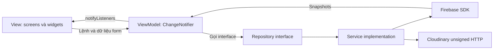

# Kiến trúc Deadline Mate

Tài liệu mô tả mã nguồn hiện có ngày 03/11/2026. Đây là phần giải thích kỹ thuật cho báo cáo và vấn đáp; không phải bằng chứng các dịch vụ cloud đã chạy thành công.

## Luồng khởi động và phiên người dùng

`main.dart` tạo MaterialApp với AppTheme. BootstrapViewModel gọi BootstrapService để khởi tạo Firebase bằng cấu hình Android thật, cài handler Crashlytics và đăng ký FCM background handler. SetupScreen hiển thị lỗi và cho thử lại nếu khởi tạo thất bại.

AuthViewModel nghe AuthRepository.changes. GoogleAuthService lấy Google ID token, đổi sang Firebase credential và theo dõi authStateChanges. AuthGate chỉ tạo cây màn hình nghiệp vụ khi có Firebase UID. MultiProvider mang ValueKey(uid), bên trong có Navigator riêng: đăng xuất hoặc đổi UID hủy cả route stack, ViewModels và subscriptions của phiên cũ.

SessionNavigator dùng NavigatorPopHandler và maybePop để chuyển system Back vào stack bên trong, đồng thời tôn trọng PopScope của form bẩn và HomeShell. Dialog/date/time picker dùng useRootNavigator=false để giữ phạm vi provider và vòng đời của phiên. Lỗi ProviderNotFound trong dialog đã được tái hiện và sửa bằng test cùng thử nghiệm Android thật.

## Trách nhiệm từng lớp

| Lớp | Trách nhiệm thực tế | Ví dụ |
|---|---|---|
| Model | Dữ liệu miền, quy tắc thuần, tính thời lượng | Deadline.validateTitle; StudySession.elapsed/statusLabel |
| View | Form, trình bày, dialog, điều hướng | DeadlineFormScreen, DeadlineDetailScreen, HomeShell |
| ViewModel | Validation, loading/saving/error, chống bấm lặp, lọc và điều phối repository | DeadlinesViewModel, StudyViewModel, ReportsViewModel |
| Repository | Hợp đồng bất đồng bộ, có thể thay bằng fake trong test | DeadlineRepository, ReportRepository, CourseRepository |
| Service | Firebase SDK/HTTP, transaction, mapping dữ liệu | FirestoreDeadlineService, CloudinaryFileStorage |
| Theme/widget | Token và cách trình bày dùng chung | AppTheme, DeadlineCard, AppNavigation, StatusPanel |

Một số quyết định điều hướng/dialog vẫn nằm trong View. Dashboard và Calendar dùng nhiều ViewModel trong HomeShell, chưa có ViewModel riêng cho từng trang. Không mô tả dự án là đã có đúng một ViewModel riêng cho mọi screen.

## Firestore và quyền sở hữu

Các tài liệu nằm dưới `/users/{uid}/`; không cần có parent document để tồn tại subcollection. Mỗi service tạo collection reference theo UID của phiên, Security Rules kiểm tra `request.auth.uid == uid` độc lập với UI.

| Subcollection | Dữ liệu chính | Đọc/ghi |
|---|---|---|
| deadlines | title, courseId, dueAt, completed, createdAt, updatedAt | Realtime orderBy dueAt; CRUD transaction; draft ID ổn định khi thử lại |
| courses | name, code, createdAt | Realtime orderBy name; tạo môn; chưa có sửa/xóa môn |
| study_sessions | title, plannedAt, plannedMinutes, status, startedAt, endedAt, createdAt | Realtime; tạo planned; transaction planned → running → completed |
| reports | fileName, url, ownerId, itemCount, objectPath, storageProvider, createdAt | Lịch sử realtime; tạo metadata sau upload |
| notifications | title, body, targetType, targetId, read, receivedAt | Lịch sử realtime; lưu theo message ID; cập nhật read |

Rules giới hạn trường, kiểu và độ dài; bảo vệ createdAt, transition phiên học và URL metadata. Rules không chứng minh URL tồn tại, PDF tải được hoặc người gửi FCM là một tác nhân tin cậy. Rules đã pass emulator và deploy lên database thật, xem backend-deployment.md; đọc/ghi bằng UID thật còn cần kiểm chứng.

## Ba luồng chính

1. Tạo deadline: form giữ draft ID và input khi lỗi → save transaction → mở detail khi tạo mới; chỉnh sửa trả về detail hiện có. Listener cập nhật list/detail. Lọc tìm kiếm, môn và trạng thái không làm mất dữ liệu nguồn.
2. Phiên học: plan → start transaction → finish có xác nhận → completed. Thời lượng lấy từ timestamps, không đếm theo widget rebuild. Lịch hiển thị trạng thái và số phút thực tế khi hoàn thành. Việc tạo plan hiện vẫn dùng auto-ID; retry sau một kết quả ghi không rõ ràng cần kiểm tra trên Android trước khi tuyên bố phục hồi hoàn chỉnh.
3. Báo cáo: chụp danh sách deadline đang lọc → tạo PDF tiếng Việt với font đóng gói → upload Cloudinary raw → lưu URL/public ID/provider theo owner → hiện lịch sử. Chỉ báo thành công sau khi metadata ghi xong. Nếu metadata thất bại sau upload có thể còn asset mồ côi; unsigned client không có quyền xóa tùy ý.

## Dịch vụ bổ sung

- Remote Config có defaults cho dashboard_item_limit, enable_pdf_export, study_banner; limit clamp 1–50; fetch timeout 10 giây và interval một phút. Profile cho refresh/xem giá trị. Còn thiếu bằng chứng publish và đổi hành vi thật.
- FCM nhận foreground, background, onMessageOpenedApp và initialMessage. Payload phải khớp owner_uid; route chỉ chấp nhận deadline với ID hợp lệ, còn lại về inbox. Chỉ dùng nội dung demo chung vì Android có thể hiển thị notification trước khi app kiểm tra owner.
- Analytics ghi tên màn hình và các thao tác, không gửi title/email làm parameter. Firebase UID dùng định danh. Crashlytics ghi lỗi operation đã rút gọn, có handler toàn cục và demo crash chỉ trong debug. Chưa có bằng chứng DebugView/Crashlytics Console.
- Cloudinary dùng tên cloud và unsigned preset công khai qua dart-define; không có API secret trong app. Link PDF là public bearer URL; metadata owner-scoped không biến file thành tài liệu riêng tư. App chặn PDF sai header và trên 10 MiB; preset không có size limit riêng.

## Phạm vi kiểm chứng

Các unit/widget tests thay repository bằng fake để kiểm tra state và recovery. Rules tests dùng demo-deadlinemate, tách khỏi dữ liệu thật. APK đã build và cài trên emulator. Các kiểm tra này không thay thế Google login thật, ba luồng trên dữ liệu cloud, mười bài MobAI, fidelity Figma hoặc bằng chứng Console; xem test-report.md và progress.md.
