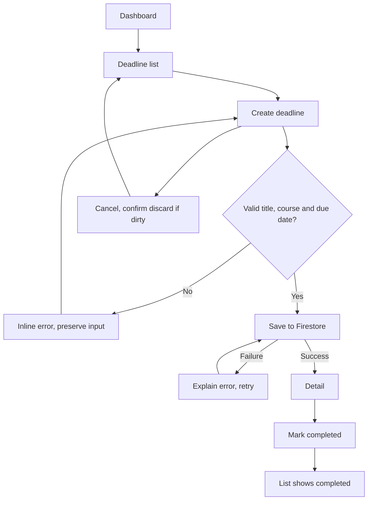
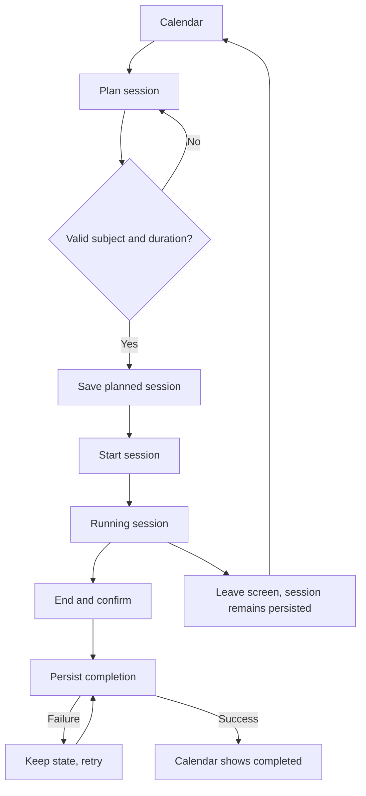
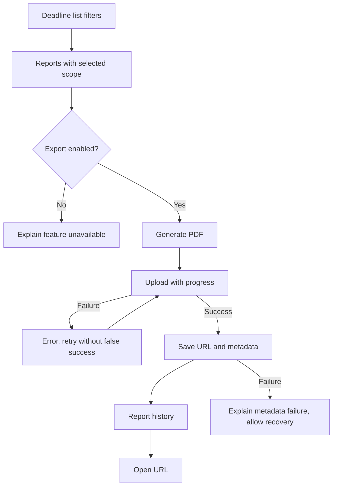

# Deadline Mate user flows

## Flow 1 Manage a deadline

Goal: persist a deadline and mark it completed. Start: authenticated dashboard. End: completed status visible in list/detail and after reload.

## Flow 2 Complete a study session

Goal: plan and record a session. Start: calendar. End: completed session with actual duration in calendar/dashboard.

Do not implement duration from widget rebuild ticks. Persist start time; reconstruct elapsed duration after navigating/restarting. Allow only valid state transitions and prevent duplicate submissions.

## Flow 3 Export a report

Goal: a valid PDF uploaded with owner metadata. Start: filtered deadline list. End: report history exposes an open action.

Screen inventory: Login; Dashboard; Deadline list; Deadline detail; Create deadline; Edit deadline; Courses; Calendar; Study sessions; Reports; Notifications; Profile. Courses reached from dashboard and forms; detail from list/calendar/notification. No dialog counts as an extra screen.
